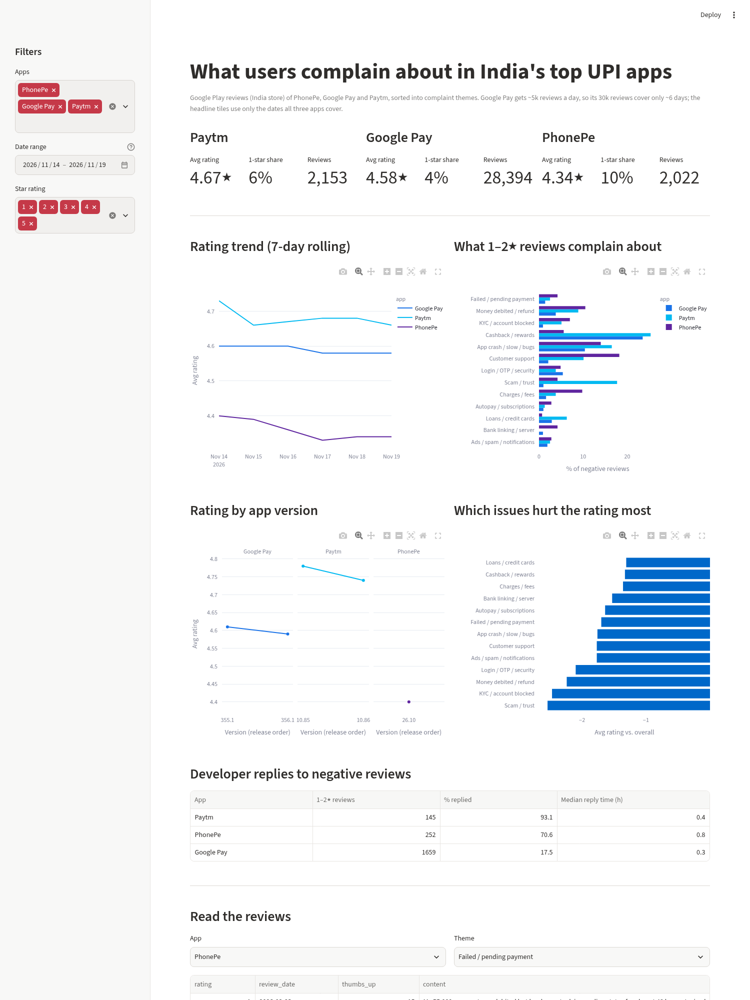
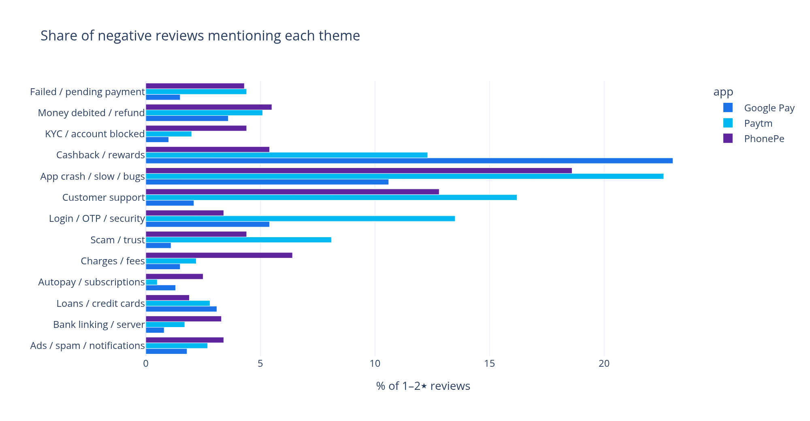
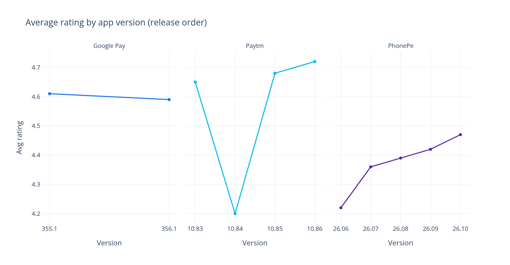

# What users complain about in India's top UPI apps

An analysis of **90,000 Google Play reviews** of **PhonePe, Google Pay and Paytm** (India store, Sep–Nov 2026). I scraped the reviews myself, cleaned them in Python, analysed them with SQL, sorted complaints into themes and built a Streamlit dashboard.

**Live dashboard:** _add Streamlit Cloud link_ · **Notebook:** [`notebooks/analysis.ipynb`](notebooks/analysis.ipynb) · **SQL:** [`sql/queries.sql`](sql/queries.sql)



## Key findings

| | PhonePe | Google Pay | Paytm |
|---|---|---|---|
| Avg rating (14–19 Nov, same dates for all apps) | **4.34★** | 4.58★ | 4.67★ |
| 1★ share | **10.5%** | 4.4% | 6.0% |
| #1 complaint in 1–2★ reviews | App crash / bugs (19%) | Cashback / rewards (23%) | App crash / bugs (23%) |
| Negative reviews replied to | 73% | 18% | 94% |

1. **PhonePe has the lowest rating of the three.** Its 1★ share is 2.4× Google Pay's.
2. **Each app has a different main complaint.** Google Pay's unhappy users complain about cashback and rewards. Paytm's complain about crashes, support and security-check errors. PhonePe has the highest share of **fee** complaints (6.4%, compared with 1.5–2.2%), **KYC/blocked accounts** and **bank linking**.
3. **The most frequent complaints are not the most damaging.** Cashback complaints average 2.89★. **Scam/trust (1.24★)**, **blocked accounts (1.60★)** and **customer support (1.67★)** have the lowest ratings.
4. **One bad release can move the rating.** Paytm 10.84 dropped to 4.20★ (−0.45), and 41% of its negative reviews were about crashes. The next version recovered to 4.68★.
5. **Fees caused PhonePe's worst day.** On 18 Sep it averaged 3.61★ with 31% 1★ reviews, and charges/fees (mostly platform fees on recharges) were the top complaint.




### Recommendations (for PhonePe)
- Show fees clearly before the user pays (recharge checkout). It's PhonePe's clearest point of difference from competitors, and it caused its worst day.
- Make blocked-account and KYC cases easier: show the case status in the app and offer a human escalation path.
- Monitor crashes per release and roll out new versions in stages.
- Measure whether replies solve the problem, not just how many reviews get one.

## Method

```
scrape.py  ──►  clean.py  ──►  themes.py  ──►  queries.sql  ──►  notebook + dashboard
30k newest     dedupe, dates,   keyword        window functions,
reviews/app    language, week,  taxonomy →     CTEs, LAG, ROW_NUMBER
(no user       shared date      review_themes
 names)        window flag
```

- **Data:** the newest 30k reviews per app, collected with `google-play-scraper` (`lang=en`, `country=in`). Usernames and avatars are never stored.
- **Fair comparison:** Google Pay gets about 4,300 reviews a day, PhonePe about 470 and Paytm about 390. Their 30k samples therefore cover about 6 days for Google Pay and about 2 months for the others. Cross-app ratings use only the dates all three cover (`in_common_window`).
- **Short reviews:** 70–79% of reviews are under 3 words ("good", "nice app") and mostly 5★. They're kept for rating statistics but not theme-tagged.
- **Themes:** an explainable regex taxonomy with 13 complaint themes, including Hinglish phrases ("paise nahi aaye", "open nahi ho raha"). I refined it after reading samples of reviews it missed and hand-checking a sample of 50.

### SQL highlights (`sql/queries.sql`)
- `daily_trend`: 7-day rolling average with `AVG() OVER (ROWS BETWEEN 6 PRECEDING AND CURRENT ROW)`
- `version_ratings`: change in rating from one release to the next, with `LAG()` ordered by when each version first appears
- `worst_version`: CTE + `ROW_NUMBER()` per app
- `reply_stats`: median reply time, computed with window functions because SQLite has no `MEDIAN()`
- `complaint_themes`: each theme's share of an app's negative reviews, using multi-CTE joins

## Run it

```bash
uv sync
make scrape      # ~30 min, writes data/raw/*.parquet (optional, data/reviews.db is included)
make all         # clean → themes → execute notebook (writes reports/figures)
make dashboard   # streamlit run dashboard/app.py
make sample      # print 50 tagged reviews for a manual check of the themes
```

## Limitations
- Play Store reviewers choose themselves, and most write only when something goes wrong, so this measures *pain points*, not overall satisfaction.
- About 60% of negative reviews get a specific theme; most of the rest are generic ("worst app, don't use").
- The theme spikes show what users said at the time; they don't prove the cause.
- English and Hinglish only. Reviews in Devanagari and other scripts are excluded from theme tagging.

## Stack
Python (pandas, scikit-learn), SQLite, Plotly, Streamlit, Jupyter, uv.
